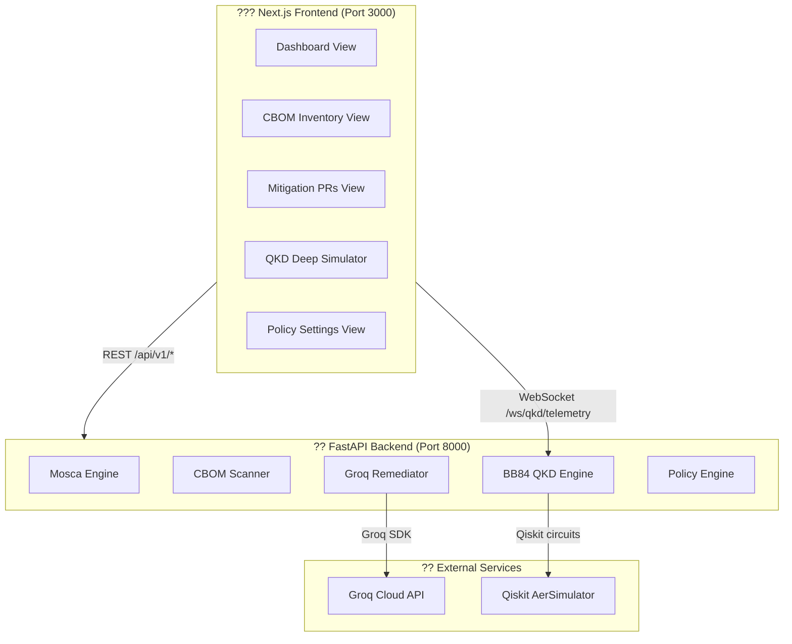

<div align="center">

# Q-Shield ?????

### Enterprise Post-Quantum Cryptography & Quantum DevSecOps Platform

**VTU-QFF-HC-0198** &nbsp;|&nbsp; Tier: **Online** &nbsp;|&nbsp; Track: **Quantum Cryptography & Security**

[](LICENSE)
[](https://www.python.org/)
[](https://nextjs.org/)
[](https://fastapi.tiangolo.com/)
[](https://qiskit.org/)
[](https://csrc.nist.gov/pubs/fips/203/final)

</div>

---

<div align="center">

| | |
| :--- | :--- |
| **Team** | Dynamic Duo |
| **Team ID** | VTU-QFF-HC-0198 |
| **Tier** | Online |
| **Repository** | [vtu-hc-dynamic-duo](https://github.com/vtu-qiskit-fall-fest-2026/vtu-hc-dynamic-duo) |
| **Organisation** | [vtu-qiskit-fall-fest-2026](https://github.com/vtu-qiskit-fall-fest-2026) |
| **Event** | VTU-QFF Hackathon — VTU-Qiskit Fall Fest 2026 |

</div>

---

## ?? Table of Contents

- [Team Members](#-team-members)
- [Problem Statement](#-problem-statement)
- [Proposed Solution](#-proposed-solution)
- [Key Features](#-key-features)
- [Architecture](#-architecture)
- [Tech Stack](#-tech-stack)
- [Project Structure](#-project-structure)
- [API Reference](#-api-reference)
- [How to Run](#-how-to-run)
- [Environment Variables](#-environment-variables)
- [How to Push Code](#-how-to-push-code)
- [Submission Checklist](#-submission-checklist)
- [Resources](#-resources)
- [License](#-license)

---

## ?? Team Members

| # | Name | GitHub Username | Role |
| :-- | :--- | :--- | :--- |
| 1 | Vishnu | vishnu-borutosarada | _Team Lead / Full-Stack & Backend Engineer_ |
| 2 | Ramya Arunachalam | RamyaArun07 | _Developer / Quantum Circuit Engineer_ |

---

## ? Problem Statement

**Track / Category:** Quantum Cryptography & Security

Adversaries are actively executing **"Harvest Now, Decrypt Later" (HNDL)** attacks — stealing today's encrypted data with the explicit intent of decrypting it once fault-tolerant quantum computers become available. Modern enterprises suffer from massive **crypto-agility debt**: they lack visibility into where vulnerable legacy cryptography (RSA, ECDSA, AES-128) is hardcoded across their complex microservice infrastructure.

**Why it matters:**
- Highly sensitive data (financial records, healthcare, national security) has a confidentiality requirement of **10–30 years**.
- Data harvested today will be decrypted once a **Cryptanalytically Relevant Quantum Computer (CRQC)** arrives — estimated within **7–15 years**.
- **NIST FIPS 203/204/205** already mandates migration to Post-Quantum Cryptography (PQC).
- Manual security audits are too slow and too expensive to scale across thousands of services.

Organizations urgently need an **automated, AI-assisted platform** to discover, assess, and migrate cryptographic vulnerabilities to post-quantum standards before their data's secure shelf-life expires.

---

## ?? Proposed Solution

**Q-Shield** is a full-stack **Enterprise Post-Quantum Cryptography & Quantum DevSecOps Platform** that combines:

1. **Mosca's Theorem Engine** — Quantifies the exact exposure window using the formula `X + Y > Z`, where X = data shelf-life, Y = migration time, and Z = years until CRQC arrives.
2. **AI-Powered PQC Remediation** — Uses **Groq's `llama3-70b-8192`** LLM to generate production-ready unified git diff patches replacing legacy RSA/ECDSA/AES-128 with NIST FIPS 203 compliant algorithms.
3. **Live CBOM Scanner** — A **Cryptographic Bill of Materials** (CycloneDX 1.6 compliant) scanner using static AST analysis and live TLS socket probing.
4. **BB84 QKD Simulator** — A real **Qiskit AerSimulator** implementation of the Bennett-Brassard 1984 quantum key distribution protocol with live eavesdropper injection and WebSocket telemetry.
5. **Hybrid KEM Sidecar Orchestrator** — Performs a real **X25519 + ML-KEM-768** hybrid key exchange and generates production-ready **Envoy v3 sidecar YAML**.

**Key idea:** Bridge the quantum security gap by automating the full discovery ? assessment ? remediation ? deployment lifecycle using quantum simulation (Qiskit), AI code patching (Groq), and cryptographic standards (NIST FIPS 203/204/205).

---

## ? Key Features

### ?? Mosca's Theorem Risk Engine
- Real-time computation of `X + Y > Z` (Mosca's Inequality)
- Quantified HNDL exposure window in years
- Enterprise KPI dashboard: total cryptographic assets, Shor/Grover vulnerability counts, PQC migration progress
- Compliance mode enforcement (NIST FIPS 203/204 Enforced)

### ??? Cryptographic Bill of Materials (CBOM)
- **CycloneDX 1.6** compliant cryptographic asset inventory
- Covers 4,821+ cryptographic primitives across 87 monitored repos and pods
- Risk categories: **Shor's Vulnerable**, **Grover's Vulnerable**, **Deprecated**, **PQC Compliant**
- Live scanner: static AST regex + live HTTPS/TLS socket probing
- Export to CycloneDX 1.6 JSON with NIST migration paths and risk scores
- Per-asset detail: algorithm, key length, file path, line number, code snippet, recommended PQC replacement

### ?? Groq AI Remediation Engine
- **Groq `llama3-70b-8192`** (ultra-fast inference, <1 second response)
- Generates unified git diff patches replacing RSA/ECDSA with ML-KEM-768 / ML-DSA-65
- PR metadata: branch name, author, CI/CD status, NIST compliance tag
- Static template fallback when API key is not configured
- Tracks enterprise PQC migration progress percentage in real time

### ?? Hybrid PQC Sidecar Proxy
- Real **X25519 classical DH** + **ML-KEM-768 post-quantum KEM** hybrid handshake
- 256-bit shared secret derivation via **HKDF-SHA384**
- Auto-generates production **Envoy v3 sidecar YAML** (`X25519MLKEM768` cipher suite)
- Zero-downtime migration with `istio.io/inject: "true"` annotation

### ?? BB84 Quantum Key Distribution Simulator
- Full **Qiskit AerSimulator** BB84 circuit implementation
- Alice encodes single photons using **Pauli-X + Hadamard** gates
- **Eve (eavesdropper)** mid-circuit measurement collapse with real QBER spike to ~25%
- Bob basis reconciliation with automatic abort above **11% QBER threshold**
- Real-time **WebSocket telemetry** at 1.2s intervals
- Photon-by-photon sample table: Alice basis, Eve basis, Bob basis, error flag
- Metrics: raw key rate (kbps), sifted key rate, secret key rate (bps), Bell state fidelity

### ?? Interactive Dashboard
- Dark/light mode toggle
- Quantum Risk Heatmap (impact severity vs ease of exploitation)
- Real-time KPI cards with animated counters
- CBOM Summary Table with filterable risk categories
- Global `Ctrl+K` Quick Search across all cryptographic assets
- Fully responsive layout (mobile to desktop)

### ?? Policy & Compliance Governance
- Toggle FIPS 203 (ML-KEM) and FIPS 204 (ML-DSA) enforcement
- CI/CD merge block gate for Shor-vulnerable algorithms
- CNSA 2.0 timeline enforcement (`2030-strict`)
- `Strict` / `Audit` / `Permissive` enforcement modes

---

## ?? Architecture



### Data Flow

```
User Input (risk params / target / asset ID)
        ?
Next.js Frontend (API call via lib/api.ts)
        ?
FastAPI Backend ? Services
   +-- Mosca Engine       ? Risk Score + HNDL Exposure Window
   +-- CBOM Scanner       ? Cryptographic Asset Inventory (CycloneDX 1.6)
   +-- Groq Remediator    ? AI-generated PQC git diff patch (llama3-70b-8192)
   +-- Hybrid KEM         ? X25519+ML-KEM-768 handshake + Envoy v3 YAML
   +-- BB84 Engine        ? Qiskit AerSimulator ? QBER + telemetry
        ?
Dashboard / Drawer / WebSocket stream ? User
```

---

## ??? Tech Stack

### Frontend

| Layer | Technology | Version |
| :--- | :--- | :--- |
| Framework | Next.js (App Router) | ^14.2 |
| Language | TypeScript | ^5.6 |
| UI Components | React | ^18.3 |
| Styling | Tailwind CSS | ^3.4 |
| Charts | Recharts | ^2.13 |
| Icons | Lucide React | ^0.453 |
| Utilities | clsx, tailwind-merge | latest |

### Backend

| Layer | Technology | Version |
| :--- | :--- | :--- |
| Framework | FastAPI | ^0.110 |
| Server | Uvicorn (ASGI) | ^0.28 |
| Data Validation | Pydantic v2 | ^2.6 |
| LLM Engine | Groq SDK (llama3-70b-8192) | ^0.9 |
| Quantum SDK | Qiskit | ^1.0 |
| Quantum Simulator | Qiskit Aer (AerSimulator) | ^0.14 |
| Cryptography | cryptography (X25519, HKDF) | ^42.0 |
| Real-time | WebSockets | ^12.0 |
| Numerics | NumPy | ^1.26 |
| Env Management | python-dotenv | ^1.0 |

### Standards & Protocols

| Standard | Description |
| :--- | :--- |
| NIST FIPS 203 | ML-KEM (Kyber) — Key Encapsulation |
| NIST FIPS 204 | ML-DSA (Dilithium) — Digital Signatures |
| NIST FIPS 205 | SLH-DSA (SPHINCS+) — Hash-based Signatures |
| CycloneDX 1.6 | Cryptographic Bill of Materials format |
| IETF Hybrid TLS | X25519_MLKEM768 hybrid key exchange |
| CNSA 2.0 | NSA Commercial National Security Algorithm Suite 2.0 |
| BB84 | Bennett-Brassard 1984 Quantum Key Distribution protocol |

---

## ?? Project Structure

```text
vtu-hc-dynamic-duo/
+-- README.md                    # This file
+-- LICENSE                      # MIT License
+-- .gitignore
+-- start_dev.bat                # One-click Windows dev launcher (both servers)
+-- requirements.txt             # Root Qiskit/quantum dependencies
¦
+-- backend/                     # FastAPI Python backend
¦   +-- main.py                  # App entry point + all API route definitions
¦   +-- requirements.txt         # Backend Python dependencies
¦   +-- .env                     # Local secrets (gitignored)
¦   +-- .env.example             # Environment variable template
¦   +-- test_endpoints.py        # API endpoint tests
¦   +-- models/
¦   ¦   +-- schemas.py           # All Pydantic request/response models
¦   +-- services/
¦       +-- mosca_engine.py      # Mosca theorem calculator + dashboard KPIs
¦       +-- cbom_scanner.py      # CBOM inventory, AST scanner, TLS prober, CycloneDX export
¦       +-- groq_remediator.py   # Groq LLM PQC patch + X25519+ML-KEM-768 hybrid KEM
¦       +-- pqc_remediator.py    # PQC migration state tracker
¦       +-- qkd_bb84.py          # Qiskit AerSimulator BB84 QKD protocol engine
¦
+-- src/                         # Next.js frontend (App Router)
¦   +-- app/
¦   ¦   +-- layout.tsx           # Root layout + metadata
¦   ¦   +-- page.tsx             # Main SPA shell + view router + dark mode
¦   ¦   +-- globals.css          # Global styles + Tailwind base
¦   +-- components/
¦   ¦   +-- layout/
¦   ¦   ¦   +-- Header.tsx       # Top bar: env selector, dark mode, search
¦   ¦   ¦   +-- Sidebar.tsx      # Left nav: Dashboard/CBOM/Mitigation/QKD/Settings
¦   ¦   +-- dashboard/
¦   ¦   ¦   +-- MoscaTheoremBanner.tsx        # Mosca KPI banner with risk dial
¦   ¦   ¦   +-- QuantumRiskHeatmap.tsx        # Impact x Exploitability scatter heatmap
¦   ¦   ¦   +-- QkdSimulatorModule.tsx        # Compact BB84 telemetry widget
¦   ¦   ¦   +-- HybridPqcRemediationPanel.tsx # Hybrid KEM sidecar deployment UI
¦   ¦   ¦   +-- CbomSummaryTable.tsx          # Top 5 critical CBOM assets
¦   ¦   +-- cbom/
¦   ¦   ¦   +-- CbomInventoryView.tsx         # Full CBOM table + filters + export
¦   ¦   ¦   +-- CbomDetailDrawer.tsx          # Slide-out asset detail + remediation
¦   ¦   +-- mitigation/
¦   ¦   ¦   +-- MitigationPrsView.tsx         # AI-generated PR list
¦   ¦   ¦   +-- PrDiffModal.tsx               # Unified diff viewer modal
¦   ¦   +-- simulator/
¦   ¦   ¦   +-- QkdDeepSimulatorView.tsx      # Full BB84 deep-dive simulator
¦   ¦   +-- settings/
¦   ¦   ¦   +-- PolicySettingsView.tsx        # FIPS enforcement policy config
¦   ¦   +-- common/
¦   ¦       +-- QuickSearchModal.tsx          # Ctrl+K global asset search
¦   +-- lib/
¦       +-- api.ts               # All backend API call functions
¦       +-- mock-cbom-data.ts    # CBOM type definitions + mock data
¦       +-- mock-prs-data.ts     # PR type definitions + mock data
¦       +-- mock-qkd-data.ts     # QKD telemetry mock data
¦       +-- utils.ts             # Shared utility functions
¦
+-- next.config.mjs              # Next.js config
+-- tailwind.config.js           # Tailwind theme config
+-- postcss.config.mjs           # PostCSS config
+-- tsconfig.json                # TypeScript config
+-- package.json                 # Node dependencies
```

---

## ?? API Reference

Base URL: `http://localhost:8000`
Interactive docs: `http://localhost:8000/api/docs`

### System

| Method | Endpoint | Description |
| :--- | :--- | :--- |
| `GET` | `/api/v1/health` | Liveness probe — backend status, Groq availability, PQC migration % |

### Dashboard & Mosca's Theorem

| Method | Endpoint | Description |
| :--- | :--- | :--- |
| `GET` | `/api/v1/dashboard/summary` | Enterprise KPI summary (Mosca deficit, asset counts, migration %) |
| `POST` | `/api/v1/mosca/calculate` | Calculate Mosca's Inequality `X + Y > Z` |

Query params for `GET /api/v1/dashboard/summary`:

| Param | Default | Description |
| :--- | :--- | :--- |
| `shelf_life` | `15.0` | X: Data confidentiality shelf-life (years) |
| `migration` | `3.0` | Y: Enterprise PQC migration horizon (years) |
| `crqc` | `7.0` | Z: Years until CRQC |

### CBOM

| Method | Endpoint | Description |
| :--- | :--- | :--- |
| `GET` | `/api/v1/cbom/inventory` | Full CBOM asset inventory (filterable by risk category) |
| `POST` | `/api/v1/cbom/scan` | Dynamic scan: code snippet, local file, or TLS endpoint |
| `GET` | `/api/v1/cbom/export` | Export CBOM as CycloneDX 1.6 JSON |

### AI PQC Remediation

| Method | Endpoint | Description |
| :--- | :--- | :--- |
| `POST` | `/api/v1/remediate/pr` | Generate AI PQC code patch (Groq llama3-70b-8192) |
| `POST` | `/api/v1/remediate/proxy` | Deploy Hybrid X25519+ML-KEM-768 sidecar proxy |

### BB84 QKD Simulation

| Method | Endpoint | Description |
| :--- | :--- | :--- |
| `POST` | `/api/v1/qkd/simulate` | Run a single BB84 simulation |
| `WS` | `/ws/qkd/telemetry` | Real-time BB84 telemetry stream (1.2s frames) |

WebSocket control messages (send as JSON):
```json
{ "eve_active": true }   // Toggle eavesdropper on (QBER spikes to ~25%)
{ "eve_active": false }  // Disable eavesdropper (QBER returns to ~2%)
```

### Policy & Compliance

| Method | Endpoint | Description |
| :--- | :--- | :--- |
| `GET` | `/api/v1/policy` | Get active cryptographic governance policies |
| `POST` | `/api/v1/policy` | Update FIPS enforcement, merge blocks, CNSA 2.0 timeline |

---

## ?? How to Run

### Prerequisites

- **Python 3.11+**
- **Node.js 18+** and npm
- **Git**
- A **Groq API Key** — free at [console.groq.com/keys](https://console.groq.com/keys)

---

### Option A — One-Click (Windows)

```bat
start_dev.bat
```

Launches both servers in separate windows: FastAPI on port 8000, Next.js on port 3000.

---

### Option B — Manual Setup

#### 1. Clone

```bash
git clone https://github.com/vtu-qiskit-fall-fest-2026/vtu-hc-dynamic-duo.git
cd vtu-hc-dynamic-duo
```

#### 2. Backend

```bash
# Create virtual environment
python -m venv .venv

# Activate (Windows PowerShell)
.venv\Scripts\Activate.ps1
# Activate (Linux / macOS)
source .venv/bin/activate

# Install dependencies
pip install --upgrade pip
pip install -r backend/requirements.txt

# Set up environment
copy backend\.env.example backend\.env
# Edit backend/.env ? set GROQ_API_KEY=your_key
```

#### 3. Start FastAPI Backend

```bash
python -m uvicorn backend.main:app --host 127.0.0.1 --port 8000 --reload
```

- API: `http://localhost:8000`
- Swagger Docs: `http://localhost:8000/api/docs`

#### 4. Frontend

Open a new terminal:

```bash
npm install
npm run dev
```

- App: `http://localhost:3000`

---

### Running Tests

```bash
python backend/test_endpoints.py
# or
pytest backend/test_endpoints.py -v
```

---

## ?? Environment Variables

Create `backend/.env` from the provided template:

```env
# REQUIRED: Groq API Key for llama3-70b-8192 PQC code remediation
# Get your free key at: https://console.groq.com/keys
GROQ_API_KEY=your_groq_api_key_here

# Optional: Override default host/port
# HOST=0.0.0.0
# PORT=8000
```

> **Note:** If `GROQ_API_KEY` is not set, Q-Shield gracefully falls back to production-quality static patch templates. All other features (CBOM scanning, BB84 simulation, Mosca engine, sidecar proxy) work without an API key.

---

## ?? How to Push Code

### Configure Git (first time only)

```bash
git config --global user.name  "Your Name"
git config --global user.email "you@example.com"
```

### Everyday workflow

```bash
git checkout main
git pull origin main
git checkout -b feature/my-task
git add .
git commit -m "feat: add variational circuit for the search problem"
git push -u origin feature/my-task
# Open a PR on GitHub, get a review, then merge
```

### Commit message convention

| Prefix | Meaning |
| :--- | :--- |
| `feat:` | New feature |
| `fix:` | Bug fix |
| `docs:` | Documentation only |
| `test:` | Adding or fixing tests |
| `refactor:` | Code restructure, no behaviour change |
| `chore:` | Build/config/dependency changes |

**Rules:** Never push directly to `main`. Always pull before pushing. Commit often with clear messages.

---

## ? Submission Checklist

- [x] Repository created and **public**
- [x] All team members added as **collaborators** and invitations accepted
- [x] `README.md` updated with full project details, problem statement, and solution
- [x] Team members listed
- [x] `requirements.txt` committed and project runs from a clean clone
- [x] Code pushed to `main` and the latest `main` builds successfully
- [x] Architecture diagram and full API reference included
- [ ] Demo screenshot / video link added
- [ ] Short project summary submitted on the hackathon portal

---

## ?? Resources

| Resource | Link |
| :--- | :--- |
| ?? Qiskit Documentation | https://docs.quantum.ibm.com/ |
| ?? Qiskit Aer Simulator | https://qiskit.github.io/qiskit-aer/ |
| ?? NIST FIPS 203 (ML-KEM) | https://csrc.nist.gov/pubs/fips/203/final |
| ?? NIST FIPS 204 (ML-DSA) | https://csrc.nist.gov/pubs/fips/204/final |
| ?? NIST FIPS 205 (SLH-DSA) | https://csrc.nist.gov/pubs/fips/205/final |
| ?? Groq Developer Console | https://console.groq.com/ |
| ?? CycloneDX 1.6 CBOM Spec | https://cyclonedx.org/capabilities/cbom/ |
| ?? IETF Hybrid TLS Draft | https://datatracker.ietf.org/doc/draft-ietf-tls-hybrid-design/ |
| ?? Mosca Quantum Threat Timeline | https://globalriskinstitute.org/publication/quantum-threat-timeline-report-2023/ |
| ?? IBM Quantum Platform | https://quantum.cloud.ibm.com/ |
| ? FastAPI Docs | https://fastapi.tiangolo.com/ |
| ?? GitHub Docs | https://docs.github.com/ |

---

## ?? License

Released under the [MIT License](LICENSE). See `LICENSE` for details.

---

<div align="center">

**Dynamic Duo** · Team ID `VTU-QFF-HC-0198` · Tier `Online`

Built with ?? Qiskit + ?? Groq + ??? NIST FIPS 203/204/205 for the VTU-QFF Hackathon

</div>
